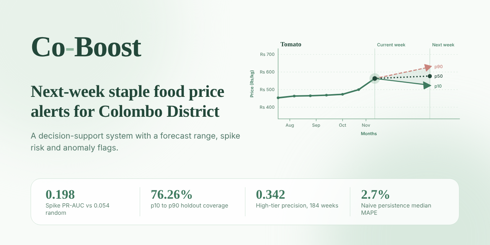
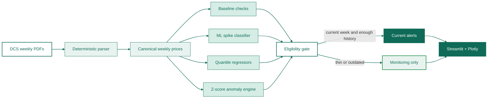

[](https://co-boost-dashboard.streamlit.app/)

# Co-Boost — Colombo food-price early warning

Co-Boost turns official weekly retail-price reports into a ranked answer for a
Colombo food-security or consumer-protection officer:

> Which commodity signals deserve verification first, what does the data
> suggest for next week, and when is the evidence not current enough to trust?

It is a decision-support system, not a guaranteed price predictor or household adviser. Built for ModelX 2.0 by Team NRZB.

## What is built

- 324 official Department of Census & Statistics (DCS) weekly retail-price
  PDFs parsed into an auditable Colombo District dataset.
- 34,535 usable observations covering 146 canonical commodities from December
  2019 through November 2026.
- Current scoring only when a commodity has at least 27 observations and
  reports the dataset's latest week. Thin or outdated series are Monitoring
  only.
- Ranked spike-risk probabilities, expected next-week movement, p10/p50/p90
  forecast ranges, anomaly flags, confidence tiers, source context, and
  interactive weekly charts.
- Safe failure: missing values are not invented, and outdated commodities are
  not presented as current alerts.

At the current data vintage, 109 commodities are eligible for current scoring
and 37 are Monitoring-only. Active alerts are a subset of the scored items.

## Architecture



## Models and outputs

| Model | Purpose | Output |
|---|---|---|
| Naive persistence | Honest price-level benchmark | Reference forecast |
| MLP spike classifier | Predicts a next-week return of at least 10% | Spike-risk probability |
| Quantile regressors | Estimate next-week p10, p50, and p90 changes | Price range |
| Z-score anomaly engine | Detect unusual levels and movements | High/low/stable/move flag |

Spike risk is the likelihood of an unusually large event; it is not a
percentage price increase. Next-week move describes expected direction and
size. Anomaly describes unusual current behavior relative to history.

## Validation

Training and testing use chronological out-of-time data rather than random
shuffling:

| Check | Result |
|---|---:|
| Spike PR-AUC versus 0.054 random base rate | 0.198 |
| High-tier precision over 184 flagged weeks | 0.342 |
| Probability calibration | Passed |
| p10–p90 holdout coverage | 76.26% |
| Naive persistence median MAPE | 2.7% |

The simple persistence forecast remains the price-level reference. The ML
system is used to prioritize unusual risk and expose uncertainty, not to claim
that a complex model always predicts exact prices better.

## Quickstart

**Live demo:** https://co-boost-dashboard.streamlit.app/

```bash
pip install -r requirements.txt
streamlit run app.py
```

The supported entry point is `app.py`. Required model and canonical data
artifacts are in `outputs/`; source PDFs are in `Dataset/`.

Submission documents:

- `SUMMARY.md` — implementation summary
- `docs/TECHNICAL_REPORT.md` — architecture, data, evaluation, limitations,
  and reproducibility

## Data and limitations

- Primary source: [DCS weekly retail prices](https://www.statistics.gov.lk/InflationAndPrices/StaticalInformation/RetailPrices).
- WFP Food Inflation - https://dataviz.vam.wfp.org/data-explorer/economic/inflation
- CBSL daily reports and open-meteo rain fall data are credited as supplementary
  sources, but are not silently merged into the current DCS operational model.
- DCS is a Colombo District aggregate, not a named-market panel.
- Filename/date mismatches, missing values, exclusions, incompatible units,
  and normalization decisions are recorded in `outputs/`.
- A commodity without the latest reporting week is withheld from current
  prediction and shown in Monitoring with its last observed date.
- Public-source terms remain applicable; see `LICENSE`.

Claude Code, Co-pilot were used for research, planning, drafting, and coding. The
team owns and is responsible for the submitted implementation and claims.

## Repository structure

| Path | Purpose |
|---|---|
| `app.py` | Supported Streamlit dashboard |
| `data.py`, `baseline.py` | Canonical data loading and cleaning |
| `alerts.py` | Current inference, eligibility, ranking, and forecast outputs |
| `Scripts/` | Extraction, training, and evaluation code |
| `Dataset/` | Official DCS source reports |
| `outputs/` | Canonical data, notes, metrics, and model bundle |
| `docs/` | Technical report and demo storyboard |

## License

MIT for repository code. Public datasets remain subject to their own terms and
are credited above.
