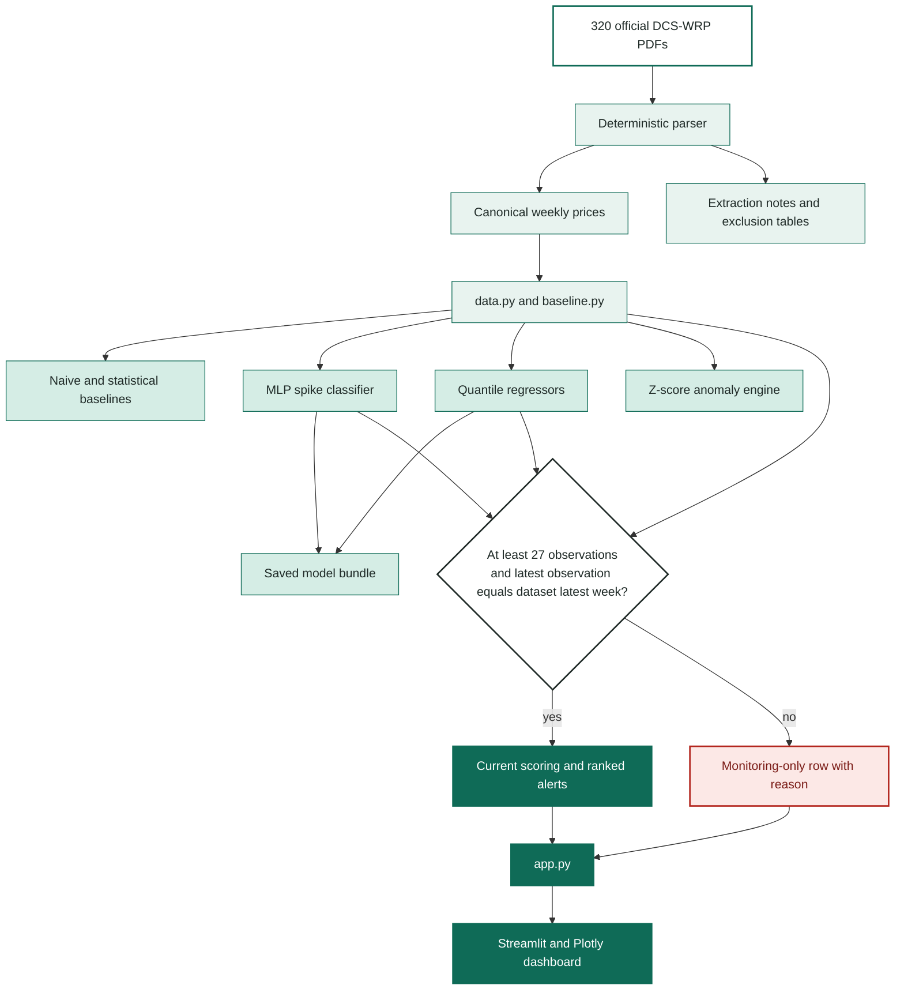

# Co-Boost Technical Implementation Report

## 1. Scope and user

Co-Boost is a Colombo-focused early-warning and decision-support system for a
district food-security or consumer-protection officer. The officer needs to
decide which staple items deserve verification first. The system ranks risks
and explains evidence; it does not make procurement, welfare, or household
decisions automatically.

The implementation deliberately narrowed the proposal's original broader
dataset ambition to a reproducible DCS weekly operational layer. This makes
source definitions, temporal freshness, and failure cases visible.

## 2. Architecture



`data.py` loads and date-normalizes the canonical dataset. `alerts.py`
performs current-week inference and creates ranked spike alerts, confidence
tiers, forecast bands, and monitoring-only rows. `Scripts/spike_ml.py` contains
the training protocol and the statistical anomaly table used by the dashboard.
Streamlit and Plotly are presentation only; the analysis modules can run
without the UI.

## 3. Data acquisition and temporality

The primary data consists of 320 DCS weekly retail-price PDFs covering
December 2019 through October 2026. Deterministic extraction produces
34,099 usable rows across 146 canonical commodities in
`outputs/official_prices_wrp.csv`. The filename is authoritative for the
reporting week when a PDF title is stale, and extraction notes record
title/filename mismatches.

Cleaning is conservative. Unicode dash variants and explicit commodity names
are normalized; non-food items and a known parsing artifact are excluded via
the auditable exclusion table. Missing, zero, incompatible, or non-retail
values are not fabricated. The current operational layer is a Colombo
District aggregate, not a named-market panel.

The dashboard exposes the latest observed week through its data vintage and
uses the source-specific weekly frequency. CBSL daily reports, WFP inflation,
and possible climate/fuel enrichments were considered, but are not silently
merged into the current DCS operational model. This is a deliberate
temporality and comparability boundary.

The current freshness rule is strict: a next-week forecast is allowed only
when the commodity has an observation in the dataset's latest reporting week.
This prevents a valid historical series from being misrepresented as a current
warning. A commodity such as Lakspray remains available for historical
inspection, but its last observation is shown and it is placed in Monitoring
until current data is available.

## 4. Models and feature engineering

The Co-Boost's engine has four complementary components:

1. **Naive persistence** is the point-forecast anchor and the benchmark that a
   richer model must justify.
2. **MLP spike classifier** predicts whether the next weekly return reaches the
   10% spike threshold.
3. **Quantile boosters** estimate p10, p50, and p90 next-week percentage
   changes, which are converted into a forecast price range.
4. **Z-score anomaly engine** flags unusual highs/lows, unusually calm recent
   behavior, and historically unusual one-week moves.

Features are calculated only from information available at week `t`: one-, two-
and four-week returns; 26-week z-score and drawdown; short/long volatility
ratio; directional streak; cyclical month encoding; and monthly food
inflation. A commodity needs at least 26 weeks for the monitoring baseline and
27 observations for the model feature vector.

## 5. Evaluation

Evaluation uses chronological out-of-time holdouts. Earlier observations are
used for model development and later unseen observations are used to measure
deployment-like behavior. The four checks below are the project's
calibration-and-reliability gates.

Training and evaluation are chronological. The 2024–2026 observations are
held out from model selection and threshold calibration:

| Gate | Evidence | Result |
|---|---|---|
| G1 | Spike PR-AUC against 0.054 random base rate | 0.198, PASS |
| G2 | High-tier precision over 184 flagged weeks | 0.342, PASS |
| G3 | Probability calibration check | PASS |
| G4 | p10–p90 holdout coverage | 76.26%, PASS |

The naive persistence baseline remains the honest price-level reference. The
dashboard therefore presents the ML classifier as a risk-ranking layer and the
quantile models as an uncertainty range, rather than implying that the ML
point forecast is universally superior.

## 6. Failure-safe behavior

Thin histories and outdated series are visible in a Monitoring view and do not
receive predictive alerts. Missing observations remain missing. Source age,
history length, confidence, and forecast horizon are shown with the output.
If data is too old, incompatible, or insufficient, the appropriate result is
an unavailable current signal, not a synthetic current price.

The dashboard is decision support. A high-risk row means “verify this first,”
not “the price will definitely rise.” The final action remains with the
officer.

## 7. Interface and demonstration

`app.py` provides:

- a ranked alert table with spike risk, expected move, confidence, and anomaly;
- an interactive historical chart with the next-week p10/p50/p90 band;
- a “Why this alert” card with model probability, momentum, history, and
  source-report verification step;
- a Monitoring view for insufficient history.
- a strict current-week eligibility check for every commodity.
- a chart showing observed weekly markers, absolute and percentage
  week-over-week changes, current price, forecast range, and zoom controls.

The local demo should show one real alert end-to-end and then deliberately show
the safe monitoring behavior. The accompanying `docs/DEMO_SCRIPT.md` keeps the
three-minute narrative aligned with what the application visibly does.

## 8. Stack and reproducibility

Python, pandas, NumPy, scikit-learn, joblib, pdfplumber, Streamlit, and Plotly
were selected because they support deterministic extraction, explainable
tabular/time-series modeling, and a lightweight local demonstration. The
repository includes the source PDFs, extraction scripts, model bundle, output
notes, requirements, and a README quickstart.

```bash
pip install -r requirements.txt
streamlit run app.py
```

AI tools were used for research, planning, drafting, and coding as disclosed
in the proposal. The team remains responsible for the implementation, data
licensing checks, reported metrics, and demonstration claims.

## 9. Implementation against the proposal

The implementation delivers the proposed ranked warning board, one-week
forecast range, anomaly signal, confidence/failure behavior, and
Colombo-focused DCS scope. It does not claim a fully reconciled named-market
CBSL/DCS panel or a live multi-source production feed. Those would require
additional crosswalks, freshness checks, and evaluation. More than that WFP dataset we mentioned in the proposal had a lot of inconsistencies, breadth without depth & fresh data. The narrower system
was chosen because a smaller verified pipeline is safer and more defensible
than an apparently richer but incomparable, inconsistent dataset.
